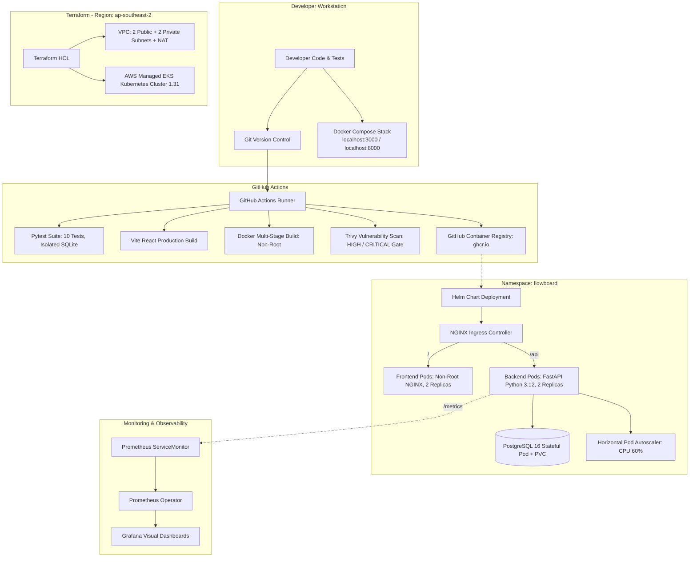

# FlowBoard — DevOps Final Capstone Project

[](https://github.com/PranavNayal/devopsProject/actions/workflows/ci-cd.yml)

A production-grade, cloud-native project management SaaS application engineered by **Pranav Nayal** to demonstrate the complete modern DevOps lifecycle: from local containerized development to automated CI/CD quality gates, container vulnerability scanning, AWS Infrastructure as Code with Terraform, Kubernetes packaging with Helm, autoscaling, and end-to-end observability.

---

## 1. Architecture Overview



---

## 2. Technology Stack & Component Details

| Layer | Technologies | Key DevOps Features |
| :--- | :--- | :--- |
| **Frontend** | React 18, Vite, Modern CSS | Multi-stage Docker build, unprivileged NGINX (UID 101), reverse proxy to API |
| **Backend** | Python 3.12, FastAPI, SQLAlchemy 2.0 | Non-root container (UID 10001), `/health`, `/ready`, Prometheus `/metrics` |
| **Database** | PostgreSQL 16 Alpine, Alembic | Managed schema migrations (`0001_create_tasks.py`), persistent volume storage |
| **Testing** | Pytest, HTTPX, SQLAlchemy StaticPool | 10 unit and integration tests with 100% endpoint coverage on isolated test DB |
| **Containerization** | Docker, Docker Compose v2 | Healthchecks, service dependencies, unprivileged execution, volume persistence |
| **CI/CD** | GitHub Actions | Parallel test & build jobs, commit SHA image tagging, automated deployment |
| **DevSecOps** | Aquasecurity Trivy | Container image vulnerability scan gating on `HIGH` and `CRITICAL` CVEs |
| **IaC** | Terraform `>= 1.7.0`, AWS Provider `~> 5.0` | Modular VPC and EKS cluster provisioned in `ap-southeast-2` (Sydney) |
| **Orchestration** | Kubernetes 1.31, Helm 3 | Custom Helm chart, Ingress routing, ClusterIP services, HPA autoscaling |
| **Observability** | Prometheus, Grafana | Automatic scraping via ServiceMonitor, live request and latency visualization |

---

## 3. REST API Specifications

The FastAPI backend exposes the following endpoints (interactive Swagger docs available at `/docs`):

| Method | Endpoint | Description | Health / Quality Role |
| :--- | :--- | :--- | :--- |
| `GET` | `/` | Service root and metadata | Basic sanity check |
| `GET` | `/health` | Liveness probe (`{"status":"UP"}`) | Kubernetes liveness probe (cheap container health) |
| `GET` | `/ready` | Readiness probe (`{"status":"READY"}`) | Verifies database connectivity before routing traffic |
| `GET` | `/metrics` | Prometheus metrics scrape | Exposes request latency, throughput, and error rates |
| `GET` | `/api/tasks` | List all tasks | Ordered by latest task first |
| `GET` | `/api/tasks/stats` | Aggregated status counts | Aggregates `TODO`, `IN_PROGRESS`, `DONE`, and total |
| `GET` | `/api/tasks/{id}` | Retrieve specific task | Returns task or `404 Not Found` |
| `POST` | `/api/tasks` | Create new task | Validates input via Pydantic (`TaskCreate`) |
| `PUT` | `/api/tasks/{id}` | Update task details / status | Partial or complete task updates |
| `DELETE`| `/api/tasks/{id}` | Delete task | Returns `204 No Content` |

---

## 4. Running Locally with Docker Compose

### Prerequisites
- Docker Engine / Docker Desktop
- Docker Compose v2

### Quick Start
```bash
# Clone the repository
git clone https://github.com/PranavNayal/devopsProject.git
cd devopsProject

# Build and start all three services (Postgres, Backend, Frontend)
docker compose up --build -d

# Check running status
docker compose ps
```

### Accessing Local Services
- **Frontend Dashboard**: [http://localhost:3000](http://localhost:3000)
- **FastAPI Interactive Docs**: [http://localhost:8000/docs](http://localhost:8000/docs)
- **Backend Health Check**: [http://localhost:8000/health](http://localhost:8000/health)
- **Prometheus Metrics**: [http://localhost:8000/metrics](http://localhost:8000/metrics)

### Teardown
```bash
# Stop containers
docker compose down

# Stop containers and wipe database volumes
docker compose down -v
```

---

## 5. Automated Testing Suite (Pytest)

The test suite runs against an isolated in-memory SQLite database via SQLAlchemy fixtures (`backend/tests/conftest.py`), ensuring tests never mutate production or development databases.

```bash
cd backend
python -m venv .venv && source .venv/bin/activate
pip install -r requirements.txt
pytest -v
```

Test coverage includes:
- `test_health`: Validates `/health` liveness probe.
- `test_ready`: Validates `/ready` database connectivity probe.
- `test_root`: Validates root metadata response.
- `test_create_task`: Validates task creation, field persistence, and default values.
- `test_list_tasks`: Validates task ordering and collection retrieval.
- `test_get_task_by_id`: Validates single task lookup.
- `test_get_task_not_found`: Validates 404 response on non-existent task ID.
- `test_update_task`: Validates status transitions and field updates.
- `test_stats_endpoint`: Validates task counter aggregations.
- `test_delete_task`: Validates deletion and subsequent 404 behavior.

---

## 6. CI/CD & DevSecOps Pipeline

The GitHub Actions workflow (`.github/workflows/ci-cd.yml`) triggers on every push to `main` and on pull requests:

1. **Test Job**:
   - Sets up Python 3.12 and installs dependencies.
   - Executes `pytest -v` (acts as an automated quality gate; pipeline terminates if any test fails).
   - Sets up Node.js 22 and runs `npm run build` on the React frontend.
2. **Build, Scan & Push Job**:
   - Logs into GitHub Container Registry (`ghcr.io`).
   - Normalizes repository owner name to lowercase to ensure valid Docker image references.
   - Builds backend and frontend images tagged with the exact Git commit SHA (`${{ github.sha }}`).
   - Scans both images with **Aquasecurity Trivy**; fails the build if any `HIGH` or `CRITICAL` unfixed vulnerabilities exist.
   - Pushes verified images to GHCR.
3. **Deploy Job**:
   - Deploys application onto Kubernetes using Helm with `--set backend.tag=${{ github.sha }}` for full traceability.

---

## 7. AWS Infrastructure as Code (Terraform)

All infrastructure is defined declaratively using Terraform in `terraform/`, pinned to AWS Region **`ap-southeast-2` (Sydney)** to comply with project policies.

```bash
cd terraform

# Initialize providers and modules
terraform init

# Validate configuration
terraform validate

# Inspect execution plan
terraform plan

# Apply infrastructure (creates VPC and EKS cluster)
terraform apply

# Connect kubectl to newly provisioned EKS cluster
aws eks update-kubeconfig --region ap-southeast-2 --name flowboard-eks --profile devops-project

# Destroy cloud resources after evaluation to prevent ongoing charges
terraform destroy
```

---

## 8. Kubernetes Deployment with Helm

The application is packaged into a reusable Helm chart located at `helm/flowboard/`:

```bash
# Create dedicated namespace
kubectl apply -f k8s/namespace.yaml

# Deploy or upgrade FlowBoard via Helm
helm upgrade --install flowboard ./helm/flowboard \
  --namespace flowboard \
  --create-namespace \
  -f helm/flowboard/values.yaml

# Verify deployment status
kubectl get pods -n flowboard
kubectl get svc -n flowboard
kubectl get hpa -n flowboard
helm list -n flowboard
```

---

## 9. Observability (Prometheus & Grafana)

1. The FastAPI backend instruments every HTTP request and exports metrics at `/metrics`.
2. A `ServiceMonitor` (`helm/flowboard/templates/servicemonitor.yaml`) configures the Prometheus Operator to scrape the backend every 15 seconds.
3. Helm values for deploying Prometheus & Grafana are located in `monitoring/prometheus-values.yaml`.

---

## 10. Troubleshooting Lab Exercises

Manifests for common operational failure modes are provided in `troubleshooting/`:

1. **ImagePullBackOff Lab**:
   ```bash
   kubectl apply -f troubleshooting/broken-image.yaml
   kubectl get pods -n flowboard
   kubectl describe pod <pod-name> -n flowboard
   ```
   *Diagnosis*: Identifies non-existent container image tag in pod events.

2. **Service Label Mismatch Lab**:
   ```bash
   kubectl apply -f troubleshooting/broken-service.yaml
   kubectl get endpoints broken-service -n flowboard
   kubectl get pods --show-labels -n flowboard
   ```
   *Diagnosis*: Service selector does not match pod labels, resulting in 0 endpoints and traffic routing failure.

---

## Presentation & Slide Deck (Module M10)

The comprehensive capstone presentation deck and speaker notes are available in the repository:
- **PDF Presentation Deck**: [`presentation/FlowBoard_DevOps_Capstone_Presentation.pdf`](presentation/FlowBoard_DevOps_Capstone_Presentation.pdf)
  - 40 widescreen (16:9) slides with diagrams covering architecture, testing, Docker, CI/CD, DevSecOps, Terraform, Kubernetes, Observability, and Live Demo runbook.
- **PowerPoint Presentation Deck**: [`presentation/FlowBoard_DevOps_Capstone_Presentation.pptx`](presentation/FlowBoard_DevOps_Capstone_Presentation.pptx)
  - 40 widescreen (16:9) editable slide deck with native shapes, diagrams, and process flowcharts.
- **Speaker Notes & Script**: [`presentation/PRESENTATION_NOTES.md`](presentation/PRESENTATION_NOTES.md)
  - Slide-by-slide talking points and demo walkthrough.
- **Presentation Generator Scripts**:
  - Python PPTX Generator: [`scripts/generate_presentation.py`](scripts/generate_presentation.py)
  - Python PDF Generator: [`scripts/generate_pdf.py`](scripts/generate_pdf.py)

---

## Author & License
- **Author**: Pranav Nayal
- **Project**: DevOps Final Capstone (Session 21)
- **License**: MIT
